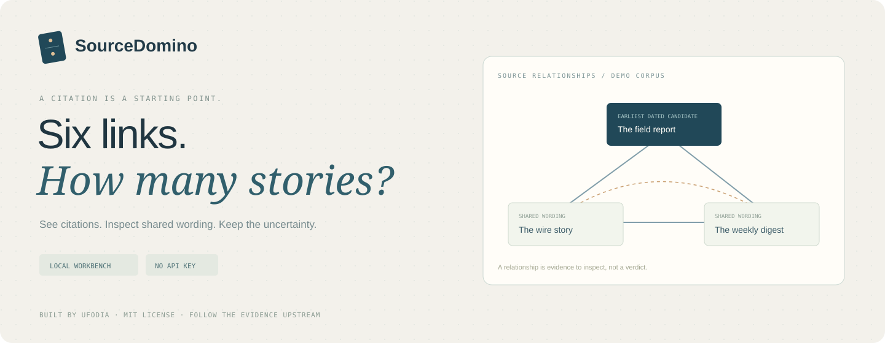
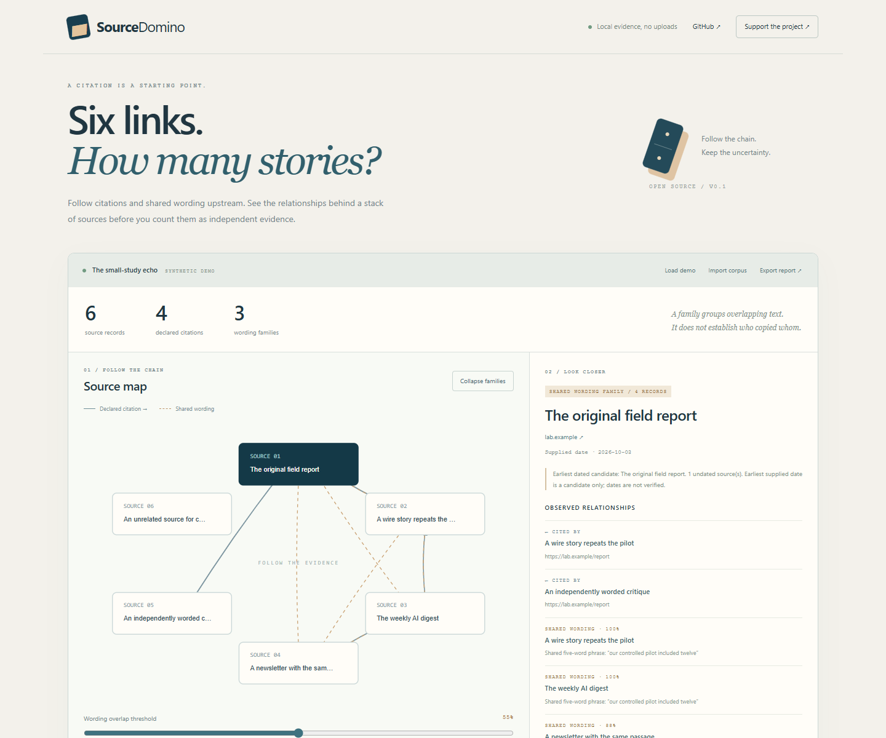

<p align="center"></p>

<p align="center"><a href="#quick-start">Quick start</a> · <a href="docs/user-guide.md">Field guide</a> · <a href="docs/formats.md">Corpus format</a> · <a href="docs/collector.md">Public URL collector</a> · <a href="https://buymeacoffee.com/ufodia">Support Ufodia</a></p>

<p align="center"></p>

**SourceDomino is an inspectable source genealogy workbench for AI citations.** Bring source text, see declared citation links and shared wording, then inspect the exact evidence behind each relationship.

Six links can contain the same passage. SourceDomino helps you notice the pattern before you count those links as independent reporting. It does not give a truth score or certify an original author.



## Quick start

Use **Node.js 24 LTS** and npm. The browser workbench needs no account, model, API key, or server-side database.

```sh
git clone https://github.com/ufodia/source-domino.git
cd source-domino
npm ci
npm run dev
```

Open the URL printed by Vite. A six-source **synthetic corpus** loads immediately. Its `.example` URLs are illustrative and are never fetched by the browser.

1. Select **The original field report** in the source map.
2. Inspect the declared citations and shared five-word phrases in the side panel.
3. Select **Collapse families** to see overlapping wording grouped together.
4. Change the threshold, edit the source text, or import your own corpus.
5. Export the evidence report as JSON.

## What you get

| Capability | Evidence you can inspect |
| --- | --- |
| Citation graph | An exact HTTP(S) URL found in supplied source text |
| Wording overlap | A containment score and a shared five-word phrase |
| Family view | Connected groups of sources whose wording overlaps above your threshold |
| Earliest dated candidate | The earliest supplied date, with ties and missing dates called out |
| Editable corpus | Source title, canonical URL, optional date, and literal source text |
| Reusable report | Sources, relationship evidence, groups, threshold, and explicit caveat |

The graph separates **solid citation arrows** from **dashed wording relationships**. A citation does not, by itself, put two sources in the same wording family.

## Bring your own sources

Paste text using **Add source**, or import a JSON file containing 2–20 records. Include citation URLs in the text to preserve visible links. A report exported by this version can be imported as a new corpus.

```json
{
  "sources": [
    { "url": "https://example.org/a", "title": "Report A", "content": "The source text and its citations." },
    { "url": "https://example.org/b", "title": "Report B", "content": "Another source cites https://example.org/a" }
  ]
}
```

The browser does not fetch websites. For explicit public URL collection, use the optional Node CLI described below. Paywalled or JavaScript-only pages may require you to paste an authorized excerpt yourself.

## Command line

Analyze the supplied example without opening the browser:

```sh
npm run analyze -- examples/corpus.json
npm run analyze -- examples/corpus.json --threshold 0.7 --out my-report.json
```

Collect only the public URLs you specify, then import the resulting corpus:

```sh
npm run collect -- --out collected-sources.json https://example.com https://example.org
```

The collector makes real network requests. It blocks local/private/reserved addresses, credentials, nonstandard ports, and non-text responses; pins a validated DNS address for each request; rechecks redirects; and limits redirects, time, and bytes. It does not crawl links, log in, execute page JavaScript, or overwrite an existing output file. See [collector behavior and limits](docs/collector.md).

## Privacy

The browser analyzes imported or pasted text in memory. No upload, model call, telemetry, cookies, or automatic persistence is used. Closing or refreshing loses the current corpus unless you export it. Following source, GitHub, or support links opens an external service.

The optional collector runs separately and sends requests to the explicit websites you provide. Those sites can observe your IP address and requested path/query. Reports contain the supplied or collected source text; keep private corpora out of public issues and commits. README badges are external images, separate from the application.

## Interpret the map carefully

- Shared wording may be a quote, boilerplate, licensed syndication, or coincidence. It does not prove copying.
- A source with no detected relationship is not automatically independent.
- Publication dates are supplied metadata, not verified evidence of first publication.
- Sources can share a missing upstream source outside your corpus.
- Paraphrases, translations, images, and claims with different wording may escape these checks.
- The tool does not verify claims, count independent factual confirmations, or assign credibility scores.

Read [the limitations](docs/limitations.md) for score details and failure cases.

## Development

```sh
npm run typecheck
npm test
npm run build
npm run preview
```

Tests cover canonicalization, input rejection, citation direction, exact URL matching, overlap containment, grouping, date uncertainty, collector address boundaries, and HTML-to-text extraction. CI runs checks and a build only; it does not deploy or collect websites.

| Area | Files |
| --- | --- |
| Pure relationship engine | `src/core.ts` |
| Accessible graph and editor | `src/main.ts`, `src/style.css` |
| Local analysis and public collection | `scripts/analyze.ts`, `scripts/collect.ts`, `scripts/collector.ts` |
| Reproducible synthetic example | `examples/corpus.json`, `examples/report.json` |

See [architecture](docs/architecture.md) and [CONTRIBUTING.md](CONTRIBUTING.md) before extending the engine.

## Support independent tools

If SourceDomino helps you untangle a citation trail, you can support Ufodia's work on clearer evidence views, corpus formats, and test cases. The core remains available under the MIT license.

<a href="https://buymeacoffee.com/ufodia"></a>

## License

[MIT](LICENSE) © 2026 **Ufodia**. Original artwork and the synthetic corpus are included under this license. Collected third-party content retains its original rights; use excerpts you are entitled to process and share. Dependency licenses remain with their respective authors.

## Browser checks

The real workbench flow is covered by [Playwright browser tests](docs/BROWSER_TESTS.md), including local exports and mobile layout. Run `npm run test:browser` after installing Chromium.
