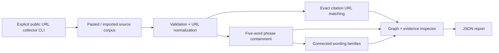

# Architecture

SourceDomino has a browser workbench and optional explicit Node CLIs. The browser has no model or remote service dependency.

## Relationship engine

`src/core.ts` is pure TypeScript. Citation edges use matching normalized URLs; overlap edges use five-word shingle containment or a contiguous normalized 12-word passage. Connected components over overlap edges define wording families. Citation edges do not merge components. Optional user-supplied dates produce candidate labels with explicit uncertainty.

## Browser workbench

`src/main.ts` keeps sources, selection, threshold, and graph mode in memory. SVG nodes are keyboard-selectable. Imported content is inserted with `textContent` or field values. Source URLs are validated HTTP(S) links and open only on explicit navigation. There is no localStorage, telemetry, worker, fetch, or persistence layer.

Small corpora use a radial source map. Larger corpora use a grid to keep node labels separated. Collapsing families changes the displayed graph but preserves the underlying pair evidence in the inspector and exported report.

## CLI boundary

`scripts/analyze.ts` calls the same core engine for local files. `scripts/collect.ts` invokes `collector.ts` only when explicitly run. Its DNS checks, public-address filter, pinned request address, redirect checks, byte limit, MIME filter, and timeouts form the collection boundary. Browser builds do not import the collector.

## Verification

Vitest covers core contracts and collector boundary functions. The synthetic six-source corpus and generated report provide an inspectable example. Type checking includes Node scripts and browser code. CI runs checks/builds without collecting external sites or deploying.
